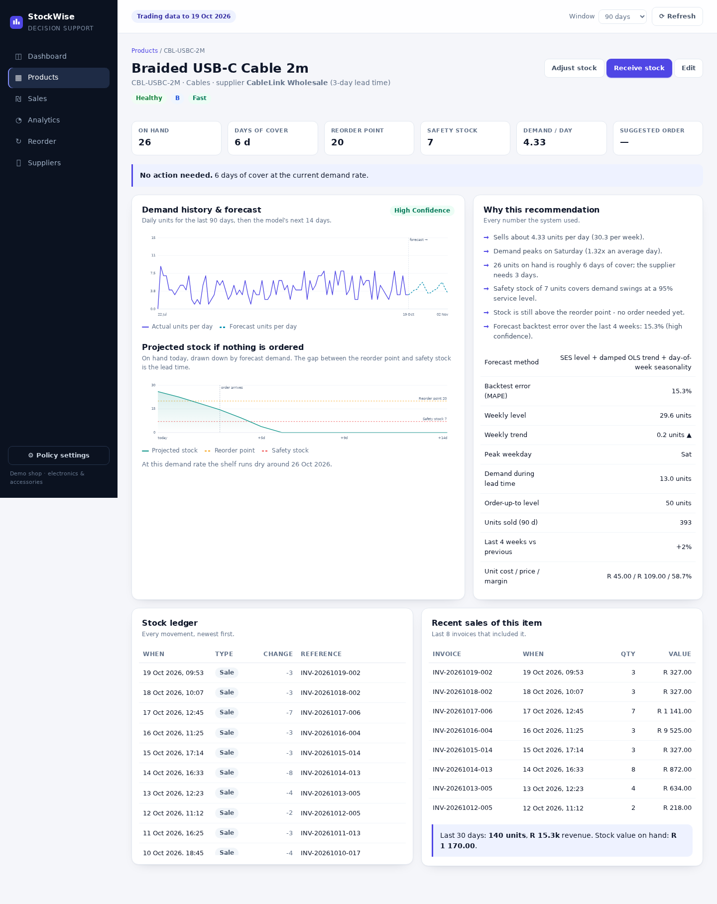
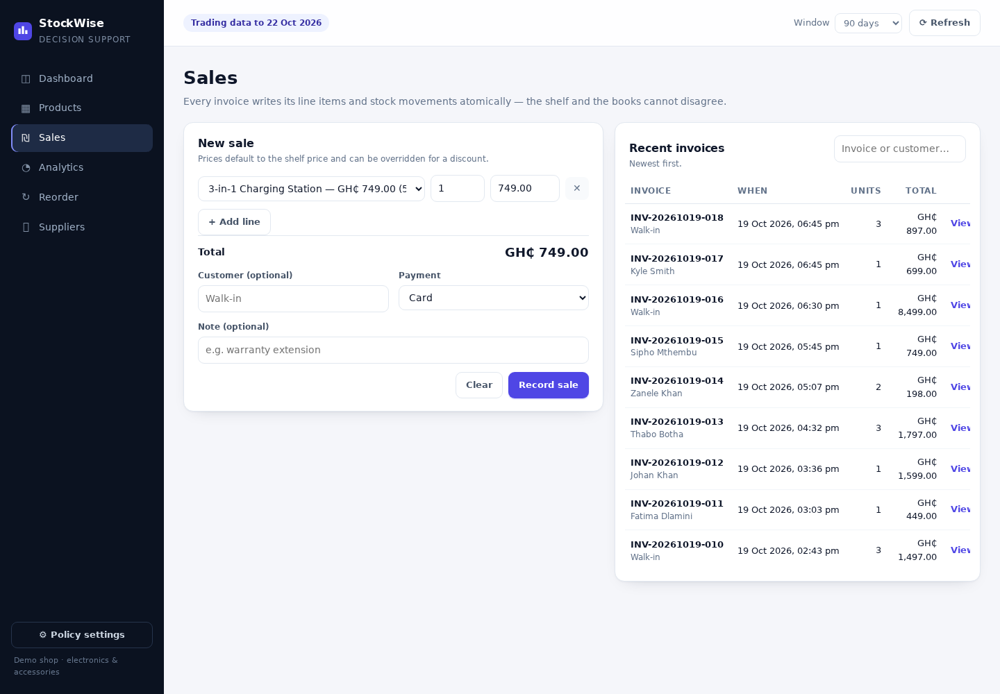

# StockWise — Inventory & Stock Decision Support

An inventory system for a small electronics retailer that does more than record products: it
uses 18 months of sales history to forecast demand, classify fast and slow movers, warn about
low stock, and recommend what to order, how much, and when.

Built for the assignment *"Inventory and Stock Management for a Small Business"* — including the
Real-World Investigation and the Programming Challenge write-up.


---

## Quick start

Requirements: **Node.js 24 or newer** (uses the built-in `node:sqlite` module — no native builds,
no runtime dependencies).

```bash
npm install          # TypeScript tooling only
npm run build
npm start            # http://localhost:3000
```

On first start the database is created at `data/stockwise.db` and seeded with 18 months of
simulated trading history (28 products, 6 suppliers, ~6 600 invoices).

Other commands:

```bash
npm test                        # build + 47 automated tests
npm run seed -- --reset         # wipe and regenerate the demo data
npm run dev                     # build and run in one step
PORT=8080 npm start             # different port
DB_PATH=./data/other.db npm start
```

---

## Deploying to Render

The repo ships a **`render.yaml`** Blueprint, so no manual dashboard configuration is needed:

1. Push the repository to GitHub.
2. In Render: **New → Blueprint →** select the repo. Render reads `render.yaml` and creates the
   service with the build command, start command, health check and environment below.
3. First deploy seeds the database automatically (~200 ms) and goes live at
   `https://<service-name>.onrender.com`.

What the Blueprint sets:

| Setting | Value | Why |
| --- | --- | --- |
| Build | `npm ci --include=dev && npm run build` | Reproducible install from the lockfile; `--include=dev` keeps TypeScript available for the build |
| Start | `npm start` | Runs `node dist/src/main.js`; binds `0.0.0.0` on Render's `PORT` |
| Health check | `/api/health` | Returns 200 once the database is open |
| Node version | `24.x` (bounded `engines.node: ">=24 <25"`) | `node:sqlite` needs Node 24; the upper bound stops Render silently moving to a future major |
| `NODE_ENV` | `production` | Set *as a service env var*, but dev deps stay installed because of `--include=dev` |

**Data on the free plan:** the filesystem is ephemeral — the SQLite file is lost on every
redeploy, restart or 15-minute spin-down. This is not an error: the app re-seeds the full demo
database on next boot (~200 ms). To keep data permanently, upgrade to a paid instance, attach a
Disk (e.g. mounted at `/var/data`), and set `DB_PATH=/var/data/stockwise.db` in the service's
environment variables (the commented-out entry in `render.yaml` shows where).

---

## What it does

| Brief requirement | Where it lives in the app |
| --- | --- |
| Record products and suppliers | **Products** and **Suppliers** pages (full CRUD) |
| Record sales | **Sales** page: multi-line invoice, price overrides, payment method |
| Monitor stock levels | **Dashboard** KPIs, per-product stock ledger, projected stock chart |
| Identify fast/slow movers | **Analytics**: ABC analysis, velocity percentiles, revenue per stock unit |
| Generate low-stock alerts | **Dashboard** "Needs attention", **Reorder** alert chips and table |
| Analyse historical sales | **Analytics**: Pareto chart, category mix, 12-week revenue trend |
| Estimate future demand | Per-product forecast (trend + weekday seasonality) with a MAPE backtest |
| Recommend replenishment | **Reorder**: supplier-grouped purchase plan, quantities, cost, reasoning |

Decision-support outputs are always explained in plain language next to the number, and the
inventory policy (service level, review period, ordering cost, holding rate) is editable in
**Policy settings** — every recommendation recalculates immediately.

---

## Screens

| Reorder plan | Product insight |
| --- | --- |
|  |  |

| Analytics | Sales |
| --- | --- |
|  |  |

---

## Tech stack

- **TypeScript** (strict, `noUncheckedIndexedAccess`) — one typed language for the domain, the
  API and the browser code.
- **Node.js 24** with the built-in HTTP server and `node:sqlite`. No Express, no ORM, no runtime
  dependency at all, so the marker can run it with `npm install && npm start`.
- **SQLite** in WAL mode: real transactions, foreign keys, check constraints.
- **Vanilla ES modules + hand-written SVG charts** in the browser.
- **`node:test`** for unit, integration and HTTP tests.

The reasoning behind those choices is written up in
[docs/02-programming-challenge.md](docs/02-programming-challenge.md).

---

## Architecture at a glance

```
browser UI (public/js)
        │  JSON over HTTP
        ▼
HTTP layer            src/server.ts · src/http/{router,api,static}.ts
        ▼
services              sales · products · suppliers · analytics · settings
        ▼                     │
domain + analytics    pure functions: stock maths, ABC/velocity, forecasting
        ▼
SQLite                WAL, integer cents, append-only stock ledger
```

- Money is stored as **integer cents**, never floating point.
- Stock is **not a column**: it is the sum of an append-only movement ledger.
- A sale writes its header, line items and stock movements in **one transaction**; a short line
  rolls the whole sale back.
- All forecasting and reorder mathematics are **pure functions** with no I/O, unit tested in
  isolation.

Full design, ERD and formulas: [docs/03-design.md](docs/03-design.md).

---

## Project structure

```
src/
  domain/        money.ts, stock.ts (safety stock, ROP, EOQ), classification.ts, types.ts
  analytics/     forecast.ts (SES + trend + seasonality + MAPE), decision.ts
  services/      sales.ts, products.ts, suppliers.ts, analytics.ts, settings.ts
  http/          router.ts, api.ts, static.ts
  db/            schema.ts, connection.ts, seed.ts, seed-cli.ts
  server.ts      HTTP server
  main.ts        entry point
public/
  index.html, styles.css, js/{app,api,format,ui,charts}.js, js/views/*
tests/           47 tests: stock maths, forecasting, classification, sales, HTTP API
docs/            investigation, programming challenge, design, report
tools/           ui-check.cjs (headless browser smoke test, dev only)
```

---

## API

| Method | Path | Purpose |
| --- | --- | --- |
| GET | `/api/health` | Liveness and product count |
| GET | `/api/dashboard?window=90` | KPIs, alerts, movers, trend, categories |
| GET | `/api/products` | Catalogue with live stock (`search`, `category`, `includeInactive`) |
| POST/PUT | `/api/products[/:id]` | Create / update a product |
| GET | `/api/products/:id/insight?window=90` | Decision, forecast, chart series, ledger, sales |
| POST | `/api/products/:id/stock` | Receive purchase / return / adjustment |
| GET | `/api/suppliers` | Suppliers with product count and stock value |
| POST/PUT/DELETE | `/api/suppliers[/:id]` | Maintain suppliers |
| GET/POST | `/api/sales` | Sales history / record a sale |
| GET | `/api/sales/:id` | Invoice with line items |
| GET | `/api/reorder?window=90` | Full decision set + supplier purchase plan |
| GET | `/api/alerts` | Low-stock alerts only |
| GET | `/api/analytics/movement?window=90` | ABC + velocity analysis |
| GET/PUT | `/api/settings` | Inventory policy parameters |

Errors are JSON: `{ "error": { "code", "message", "details" } }` with 400/404/409/405 statuses.

---

## Demo data

The seed is a deterministic discrete-event simulation, not random rows:

- 540 days of trading (2025-04-28 → 2026-10-19), 28 SKUs, 7 categories, 6 suppliers.
- Each SKU has its own demand level, weekly trend (growing / declining / steady) and month
  seasonality (December and Black Friday peaks, quiet January).
- The simulated owner reorders at a reorder point and waits for the lead time, so the history
  contains real stockouts: **171 units of demand were lost**, three products are out of stock at
  the end of the history and eleven sit at or below their reorder point.
- One supplier misses its last delivery, one product was discontinued 15 months ago (dead stock),
  and the `FitTrack Band 3` is trending — exactly the patterns the analytics are meant to find.

Regenerate any time with `npm run seed -- --reset`. The PRNG is fixed, so the same day's seed
produces the same dataset.

---

## Tests

```
npm test
ℹ tests 47
ℹ pass 47
ℹ fail 0
```

Coverage includes safety stock / reorder point / EOQ edge cases, ABC and velocity classification,
forecast behaviour on flat, growing, empty and seasonal series, MAPE backtesting, the decision
builder, weighted-average costing, oversell rejection and full transaction rollback, invoice
numbering, policy settings validation, and the HTTP API end to end (including static file
serving and directory-traversal protection).

`tools/ui-check.cjs` is an optional headless-browser smoke test used during development; it
needs Playwright installed and is not part of `npm test`.

---

## Documentation

1. [Real-world investigation](docs/01-real-world-investigation.md) — how the shop manages stock
   today, findings, requirements, interview guide.
2. [Programming challenge](docs/02-programming-challenge.md) — why TypeScript, Node and SQLite,
   and why the architecture mixes a transactional core with functional analytics.
3. [System design](docs/03-design.md) — ERD, data dictionary, formulas, API, assumptions.
4. [Project report](docs/04-report.md) — submission-ready write-up with results and evaluation.

---

## Known limitations

- Single-node SQLite: perfect for one shop and one process, not for multi-branch sync.
- The forecast is deliberately simple (weekly SES + damped trend + weekday factors). It is
  explainable and accurate enough for a small range, but it does not model promotions, holidays
  or competitor effects.
- Supplier lead times are treated as reliable and demand as independent day to day.
- No authentication: the app is a local decision-support tool, not a multi-user cloud service.
- The investigation in `docs/01` is a structured template based on the case brief; replace its
  observation notes with your own verified interview data before submitting.
