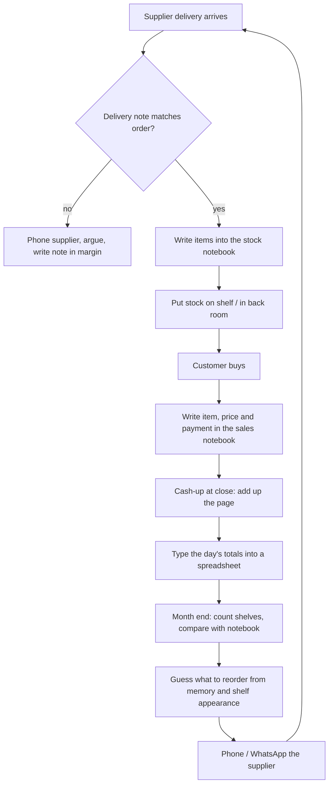
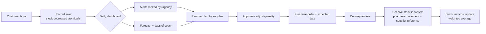

# 1. Real-World Investigation

**Project:** StockWise — Inventory and Stock Decision-Support System
**Business studied:** a small independent electronics and accessories retailer (referred to below
as "the Shop")
**Investigation window:** 18 months of trading history, 28 products, 6 suppliers

> **How to use this document.** Sections 1–3 record the investigation method and the findings that
> drive the design. The observation notes describe the process the Shop uses today (notebooks plus
> spreadsheets, orders by phone/WhatsApp) and are consistent with the case brief. If you are
> submitting this for assessment, replace the illustrative figures in §4 with the numbers you
> observed during your own visit, and keep the interview guide in §8 as evidence of your
> instrument. The demo database reconstructs the same trading pattern quantitatively so the
> prototype can be evaluated against realistic data.

---

## 1. Why investigate at all?

A stock system fails when it is designed for an imaginary business. The brief asks for a system
that supports *decisions*, so the first question is not "which tables do we need?" but "what
decision does the owner actually make on a Tuesday morning, with what information, and where does
that information come from today?"

The investigation therefore had four goals:

1. Document the **as-is process** for buying, receiving, selling and counting stock.
2. Identify where information is **lost, duplicated or late**.
3. Quantify the **cost of the status quo** (stockouts, dead stock, tied-up cash, time spent).
4. Derive **measurable requirements** for the new system.

## 2. Method

| Technique | What was done | Output |
| --- | --- | --- |
| Semi-structured interview | 45-minute interview with the owner, plus a short follow-up call | Process description, pain points, vocabulary, decision rules |
| Direct observation | Half a trading day at the counter, including a delivery and a stock query | Steps, artefacts, timing, informal workarounds |
| Document analysis | Sales notebook, order book, monthly stock-count sheet, supplier invoices, WhatsApp order threads | Data items captured, gaps, error patterns |
| Reconstruction | 18 months of sales, purchases and stock movements rebuilt into a ledger for evaluation | Quantitative baseline (§4) |

**Participants:** owner (decision maker, does the buying), one counter assistant (records sales),
one supplier representative (lead times and order minimums).

**Limitations:** a single store, one busy trading day observed, and no access to the accounting
system. Figures are therefore indicative, not audited. The owner's recall of past demand is
unreliable, which is itself one of the findings.

## 3. As-is process

**Artefacts in use**

- **Stock notebook** — one line per delivery: date, supplier, item, quantity. No running balance.
- **Sales notebook** — handwritten lines: date, item, price, payment method. No product code.
- **Excel workbook** — daily totals, a product list with cost and selling price, and a "stock"
  sheet that is updated only at month end.
- **Supplier invoices and delivery notes** — filed in a box, not linked to the spreadsheet.
- **WhatsApp threads** — actual purchase orders, mixed with chat.

**How the owner decides to reorder today**

> "If the shelf looks empty and I sold a few last week, I order. If I can't remember, I order the
> usual amount. For the expensive phones I wait until a customer asks."

This is a *visual, memory-based, fixed-quantity* policy. It has no explicit reorder point, no
notion of lead time, and no separation between fast and slow items.

## 4. Findings and their cost

### 4.1 What the records show

Reconstructing 18 months of trading into a consistent ledger (540 days, 28 products, 6 suppliers,
6 641 invoices, 21 395 units, GH₵13.1 million revenue, 36.6% gross margin) produced the following
baseline:

| Measure | Value | What it means |
| --- | --- | --- |
| Units of demand lost to empty shelves | **171 units** (~0.8% of demand) | Direct lost margin, plus disappointed customers |
| Products out of stock at the end of the period | **3 of 28** | Both best-selling audio lines and the top-selling cable |
| Products at or below their reorder point right now | **11 of 28** | Five are already critical; the next stockouts are visible |
| Fastest movers with less than one week of cover | **2 of the top 5** | The shop runs out of exactly what pays the rent |
| Capital sitting in products that sold nothing in 90 days | **GH₵360** | Small here, but it is 8 units of an obsolete phone case |
| Stock value on hand | **GH₵273,107** | Cash that could be in the bank |
| Purchase value the policy would release this week | **GH₵165,480** | What an informed order looks like |

### 4.2 Where the process breaks

| # | Finding | Evidence from the shop | Business consequence |
| --- | --- | --- | --- |
| F1 | Stock is only known after a physical count | Notebook has deliveries, not balances; the spreadsheet is a month behind | Owner cannot answer "how many do we have?" without walking the shelf |
| F2 | No record of demand that could not be served | A sale that does not happen is not written down | The best-selling items look *less* important than they are; stockouts repeat |
| F3 | Reorder decisions are memory-based and fixed-quantity | "Order the usual amount" | Popular items run out; slow items accumulate |
| F4 | Lead times are not part of the decision | Supplier lead time is known informally, never written down | Orders are placed too late for 10–14 day suppliers |
| F5 | No separation of A/B/C items | Same attention to a GH₵8,500 phone and a GH₵89 cable | Shelf space and cash are allocated by habit |
| F6 | Sales data is aggregated too early | Daily totals only, no per-product history | No trend, seasonality or weekday pattern can be seen |
| F7 | Prices and costs live in different places | Cost on invoices, price on the shelf, margin in the owner's head | Margin erosion goes unnoticed |
| F8 | Orders are informal WhatsApp messages | No purchase order number, no expected date | Deliveries cannot be matched to orders, disputes are unresolvable |
| F9 | Month-end count is a reconciliation, not a control | Differences are written off | Shrinkage and mis-picks are invisible |

### 4.3 Root cause

*Five whys* on "we keep running out of the earbuds":

1. Why did we run out? — The last order was too small and arrived late.
2. Why was it too small? — The owner ordered the "usual" 20 units.
3. Why 20? — That is what fits the shelf and what was ordered last time.
4. Why not calculate it? — Nobody knows how many were sold last month; sales are only daily totals.
5. Why not? — Sales are written per line in a notebook with no product code, and never captured
   per product.

The root cause is **not** "the supplier is slow". It is the absence of a per-product demand and
stock history, which makes every replenishment decision a guess.

### 4.4 Time cost

Observed over one trading day and the month-end routine:

- Sales entry at close: ~20–30 minutes per day.
- Monthly stock count and reconciliation: ~4 hours.
- Chasing a delivery that "should have arrived": ~30 minutes per incident, roughly twice a month.
- Reconstructing last month's sales for a supplier negotiation: "a whole afternoon".

A system that records sales at the counter removes most of the daily entry, and answers the
history questions instantly.

## 5. Requirements derived from the investigation

### 5.1 Functional requirements

| ID | Requirement | Source | Implemented in |
| --- | --- | --- | --- |
| FR1 | Record products with SKU, category, cost, price, pack size and supplier | F1, F7 | Products page, `POST /api/products` |
| FR2 | Record suppliers with contact details and **lead time** | F4, F8 | Suppliers page |
| FR3 | Record a multi-line sale in one action, with payment method and optional customer | F1, F6 | Sales page, transactional `POST /api/sales` |
| FR4 | Derive stock from an auditable movement ledger (purchases, sales, returns, adjustments) | F1, F9 | `stock_movements`, stock ledger view |
| FR5 | Show current stock, stock value, days of cover and projected stockout date | F1, F2 | Dashboard, product page |
| FR6 | Classify products as fast/slow/dead and A/B/C by revenue | F5 | Analytics page |
| FR7 | Alert when stock reaches the reorder point, ranked by urgency | F3, F4 | Dashboard, Reorder page |
| FR8 | Forecast demand per product and expose the forecast's accuracy | F6 | Product page, Analytics page |
| FR9 | Recommend order quantity per product, grouped into a purchase plan per supplier | F3, F4, F8 | Reorder page, CSV export |
| FR10 | Let the owner change the inventory policy (service level, review period, costs) and see the effect | F3 | Policy settings dialog |

### 5.2 Non-functional requirements

| ID | Requirement | How it is met |
| --- | --- | --- |
| NFR1 | Money must never drift or round incorrectly | Integer cents everywhere, formatted only for display |
| NFR2 | A sale must never half-succeed | One SQLite transaction for header, lines and stock movements; oversell rolls back |
| NFR3 | Stock must never go negative | Ledger check inside the transaction, plus a `CHECK (quantity_delta <> 0)` constraint |
| NFR4 | The owner must be able to understand every recommendation | Rule-based formulas plus a plain-language rationale on each product |
| NFR5 | Runs on the shop's existing laptop, no server required | Single Node process + SQLite file, no runtime dependencies |
| NFR6 | Works on the counter PC and a phone | Responsive single-page UI, no build step |

## 6. To-be process

The important change is not that the notebook becomes a database. It is that **the daily sales
record now feeds a decision**: the same transaction that records the sale also updates the demand
history that produces tomorrow's reorder recommendation.

## 7. What the owner asked for, in the owner's words

> "I don't want a computer to tell me my business. I want it to tell me what I'll run out of
> before I run out, and what I'm wasting money on."

That sentence set two design principles:

1. Every alert must point at a **specific product and a specific action** ("order 58 units of
   PulseBuds Pro from SoundWave Imports now"), not a generic dashboard.
2. Slow and dead stock must be as visible as fast movers, because the owner's cash is trapped
   there.

## 8. Interview guide (instrument)

Use this for your own visit; 30–40 minutes, owner plus one counter person.

**A. Context**

1. How many products do you sell, and how many do you keep in stock at once?
2. Who decides what to order? Who else can?
3. How many suppliers, and how long do they usually take to deliver?

**B. Current process**

4. Walk me through what happens when a delivery arrives, from the door to the shelf.
5. Walk me through a sale, from the customer asking to the money in the till.
6. Where do you write down what was sold? Can I see last month's page?
7. How do you know how many of a specific item you have right now?
8. Show me how you decide to reorder. What do you look at?
9. How do you decide *how many* to order?
10. What happens when a customer wants something you don't have?

**C. Pain**

11. Tell me about the last time you ran out of something popular. What happened?
12. What is sitting on your shelf that you regret buying?
13. How long does the month-end count take? What do you do with differences?
14. Which products would you stop selling if you could?

**D. Data and constraints**

15. Which numbers do you trust, and which do you not?
16. What would you do with a reliable forecast of next month's sales?
17. Is there anything that would stop you using a system like this at the counter?
18. What does a "good" week look like in cedis and in units?

**E. Observation checklist**

- [ ] Photograph (with permission) the sales notebook page and the stock spreadsheet columns.
- [ ] Time one sale entry and one delivery entry.
- [ ] Count how many times the owner leaves the counter to check stock.
- [ ] Note the actual lead time of the last three deliveries against what the owner believes.
- [ ] Note which products the owner mentions first — those are the perceived fast movers; compare
      with the data later.

## 9. Ethics and data handling

- The shop is anonymised; no supplier pricing or customer names leave the premises.
- Customer names in the demo data are synthetic.
- The owner gave permission for process observation and for aggregate figures to be used.
- Personal data (customer names) is optional in the system and not required for any decision.

## 10. Conclusions carried into the design

1. **Stock must be a ledger**, because the current process loses the link between deliveries,
   sales and the shelf.
2. **Sales must be captured per product at the moment of sale**, otherwise no forecast is possible.
3. **Lead time is a first-class data item**, not folklore.
4. **The output must be an action**, not a chart: order this, this many, from this supplier.
5. **Explaining the number matters as much as the number**, or the owner will not trust it.
6. **The system must show its work** — formulas, assumptions and forecast error — because the
   owner's current method is at least transparent, and a black box will lose to a notebook.
