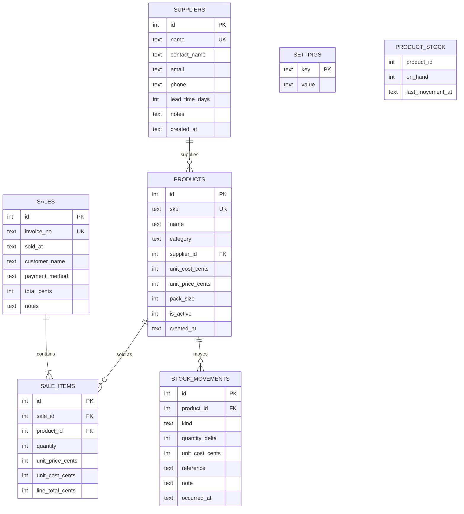

# 3. System Design

**StockWise** — inventory and stock decision support for a single small electronics retailer.

- Runtime: Node.js 24, TypeScript (strict), SQLite (`node:sqlite`)
- No runtime dependencies; TypeScript is a dev dependency
- Single-page browser UI served by the same process
- 2.3 MB database for 18 months of trading

---

## 3.1 Architecture

```
┌──────────────────────────────────────────────────────────────────────┐
│ Browser (public/)                                                    │
│  index.html · styles.css · js/app.js (hash router)                    │
│  js/views/*  dashboard · products · sales · analytics · reorder ·     │
│              suppliers                                               │
│  js/charts.js (SVG) · js/api.js (fetch) · js/ui.js · js/format.js     │
└──────────────────────────────┬───────────────────────────────────────┘
                               │ JSON / HTTP
┌──────────────────────────────▼───────────────────────────────────────┐
│ HTTP layer (src/http, src/server.ts)                                 │
│  Router (regex routes) · body parsing · ApiError → JSON · static     │
└──────────────────────────────┬───────────────────────────────────────┘
                               │ plain objects
┌──────────────────────────────▼───────────────────────────────────────┐
│ Services (src/services)                                              │
│  sales · products · suppliers · analytics · settings                 │
│  - validate input          - own transactions                        │
│  - map rows ↔ domain types - throw ApiError                          │
└───────────────┬──────────────────────────────────┬───────────────────┘
                │ arrays of numbers/dates          │ SQL
┌───────────────▼──────────────────────┐  ┌────────▼───────────────────┐
│ Functional core (src/domain,          │  │ SQLite (src/db)            │
│ src/analytics)                        │  │  WAL, FKs, CHECKs          │
│  stock maths · ABC/velocity           │  │  append-only stock ledger  │
│  forecast · decision builder          │  │  integer cents             │
│  (pure: no I/O, no clock)             │  └────────────────────────────┘
└──────────────────────────────────────┘
```

**Dependency rule:** arrows only point downwards. The domain never imports a service, the
database or HTTP; the services never build HTML. This is what allows the mathematics to be unit
tested without a database.

| Layer | Files | Responsibility |
| --- | --- | --- |
| Domain | `src/domain/{money,stock,classification,types}.ts` | Money, inventory maths, ABC/velocity, shared types and errors |
| Analytics | `src/analytics/{forecast,decision}.ts` | Demand forecasting, per-product decision assembly |
| Services | `src/services/*.ts` | Use cases, validation, transactions, row mapping |
| Persistence | `src/db/{schema,connection,seed}.ts` | Schema, pragmas, transaction helper, demo simulator |
| HTTP | `src/http/{router,api,static}.ts`, `src/server.ts` | Routing, JSON, errors, static files |
| UI | `public/js/**` | Views, formatting, charts, API client |

---

## 3.2 Data model



`PRODUCT_STOCK` is a **view**, not a table: `SUM(quantity_delta)` grouped by product. Stock is
derived, never stored.

### Data dictionary (constraints that matter)

| Table.column | Type | Constraint | Reason |
| --- | --- | --- | --- |
| `products.sku` | TEXT | `UNIQUE`, validated `^[A-Z0-9][A-Z0-9-]{1,31}$` | Stable identifier for staff and suppliers |
| `products.unit_cost_cents` | INTEGER | `CHECK >= 0` | Money as integer cents; no `REAL` anywhere |
| `products.pack_size` | INTEGER | `CHECK >= 1` | Supplier sells boxes of 5/6/10 |
| `suppliers.lead_time_days` | INTEGER | `CHECK BETWEEN 0 AND 180` | Drives every reorder point |
| `sales.invoice_no` | TEXT | `UNIQUE` | `INV-YYYYMMDD-NNN`, chronological within a day |
| `sales.payment_method` | TEXT | `CHECK IN ('cash','card','eft','mobile')` | Matches the UI union exactly |
| `sales.total_cents` | INTEGER | `CHECK >= 0` | Sum of line totals, computed in the transaction |
| `sale_items.quantity` | INTEGER | `CHECK > 0` | No zero or negative sale lines |
| `sale_items.unit_cost_cents` | INTEGER | snapshot at sale time | Gross profit of historical sales never changes when costs move |
| `stock_movements.kind` | TEXT | `CHECK IN ('purchase','sale','adjustment','return')` | Every ledger row has a reason |
| `stock_movements.quantity_delta` | INTEGER | `CHECK <> 0` | A movement that moves nothing is a bug |
| indexes | | `sales(sold_at)`, `sale_items(product_id)`, `stock_movements(product_id, occurred_at)` | Analysis queries stay flat as history grows |

### Why an append-only ledger?

1. **Auditability.** The owner can see the delivery, the sale or the shrinkage that produced the
   current count. The stock ledger view on the product page is exactly that history.
2. **Corrections are facts.** A wrong count is fixed with an adjustment row, not by overwriting the
   past. The month-end count becomes evidence rather than a silent edit.
3. **Concurrency safety.** The availability check and the deduction read and write the same
   ledger inside one `IMMEDIATE` transaction; there is no lost-update window.
4. **Analytics.** Purchases, sales and adjustments are distinguishable, so demand is derived from
   `kind = 'sale'` only.

---

## 3.3 Decision pipeline

For each active product, on every analysis request:

```
sales rows ──► dense daily series (224 days)
                     │
                     ├──► demand statistics (mean, σ, CV) ──► variability
                     │
                     └──► forecast (weekly SES + damped trend + weekday factors)
                                   │                    │
                                   ▼                    ▼
                          demand rate / day      residual σ (forecast error)
                                   │                    │
                                   ▼                    ▼
                          lead-time demand      safety stock = z·σ·√L
                                   └────────┬───────────┘
                                            ▼
                                    reorder point = rate·L + safety
                                            │
                       ┌────────────────────┴────────────────────┐
                       ▼                                         ▼
             urgency classification                    order quantity (service driven)
             (critical/reorder/watch/healthy/overstocked)        │
                       └────────────────────┬────────────────────┘
                                            ▼
                              recommendation + plain-language rationale
```

### Formulas

| Quantity | Formula | Notes |
| --- | --- | --- |
| Mean daily demand | `Σx / n` | Zero-filled days included |
| Daily standard deviation | `√(Σ(x−x̄)²/(n−1))` | Sample standard deviation |
| Recent demand rate | `0.6·mean(last 28) + 0.4·mean(last 84)` | Catches a promotion without over-reacting |
| Blended rate used | `0.75·forecast + 0.25·recent` (high/medium confidence), `0.5/0.5` (low) | Model carries trend, recent rate catches shocks |
| Safety stock | `SS = z · σ_residual · √L` | Variance adds over independent days → √L, not L |
| Reorder point | `ROP = rate · L + SS` | `L` = supplier lead time in days |
| Order-up-to level | `S = rate · (L + R) + SS` | `R` = review period (default 7 days) |
| Order quantity | `max(0, S − onHand)` rounded up to pack size | Only when `onHand ≤ ROP` (continuous review) |
| Economic order quantity (advice) | `EOQ = √(2·D·K / (c·h))` | `D` annual demand, `K` cost per order, `c` unit cost, `h` holding rate |
| Days of cover | `onHand / rate` | ∞ when rate = 0 and stock > 0 |
| Stockout date | `today + floor(daysOfCover)` | Null when no demand |
| Revenue share / cumulative | per-product revenue ÷ total, running sum | ABC boundaries at 80% and 95% |
| Velocity | `unitsPerDay` vs 75th/25th percentile of the range | `dead` when no units sold |

Constants and defaults (editable at runtime):

| Setting | Default | Why |
| --- | --- | --- |
| `serviceLevelZ` | 1.65 | ≈95% cycle service level |
| `reviewPeriodDays` | 7 | The owner orders roughly weekly |
| `orderCostCents` | R150 | Admin + transport + handling per purchase order |
| `holdingRatePct` | 22% p.a. | Capital, storage, obsolescence |
| `defaultLeadTimeDays` | 7 | Only used when a product has no supplier |

### Urgency rules (in order)

| Condition | Urgency | Meaning |
| --- | --- | --- |
| `onHand ≤ 0` | **critical** | Losing sales now |
| `rate = 0`, stock > 0 | **overstocked** | Idle capital |
| `onHand ≤ SS` or `cover < L` | **critical** | Will run out before a delivery can arrive |
| `onHand ≤ ROP` | **reorder** | Place the order now |
| `cover > 120 days` | **overstocked** | Too much cash on the shelf |
| `onHand ≤ 1.25·ROP` | **watch** | Approaching the trigger |
| otherwise | **healthy** | No action |

### Worked example (real demo data)

`CBL-USBC-2M`, Braided USB-C Cable 2m — CableLink Wholesale, lead time 3 days.

| Step | Value |
| --- | --- |
| Sales last 90 days | 393 units → 4.33 per day (blended with forecast) |
| Forecast residual σ | 2.45 units/day (backtest MAPE 25%, high confidence) |
| Safety stock | 1.65 × 2.45 × √3 = **7 units** |
| Reorder point | 4.33 × 3 + 7 = **20 units** (rounded) |
| Order-up-to level | 4.33 × (3 + 7) + 7 = **50 units** |
| On hand | 26 units → cover 6 days → above ROP → **healthy, order 0** |
| If stock fell to 19 | Trigger fires; order `50 − 19 = 31` → pack of 5 → **35 units**, ≈ R1 575 |
| EOQ (advice) | √(2 × 1 580 × 15 000 ÷ (4 500 × 0.22)) ≈ **219 units** — reported, not ordered, because it would tie up four months of cash |

---

## 3.4 Forecasting model

Chosen for **explainability and stability on 1–2 years of daily retail data**, not for
sophistication.

1. **Aggregate to complete weeks**, aligned to the end of the history. Weekly totals remove
   day-of-week noise and reduce the effect of a single quiet Tuesday.
2. **Level** by simple exponential smoothing, with the smoothing constant `α ∈ {0.05…0.95}`
   selected by minimising one-step-ahead squared error (grid search).
3. **Trend** by ordinary least squares over the last ≤26 weeks, capped at ±25% of the weekly
   level and **damped** with φ = 0.9 so it converges instead of exploding.
4. **Seasonality**: multiplicative day-of-week factors from the full history, shrunk toward 1.0
   when a weekday has few observations (`weight = n/(n+4)`), normalised to sum to 7 so weekly
   totals are conserved when redistributed.
5. **Projection**: week *h* = `level + slope · Σ_{k=1..h} φ^k`; daily values = weekly total ×
   weekday factor ÷ 7.
6. **Uncertainty**: residual σ per week → daily σ = σ_week / √7; used directly for safety stock.
7. **Accuracy**: the last 28 days are held out, the model is refitted on the rest, and MAPE is
   computed on weekly totals (weeks with zero actuals excluded).
8. **Confidence**: `high` (MAPE ≤ 25%, ≥20 weeks), `medium` (≥12 weeks, MAPE ≤ 50%), else `low`;
   `none` when there is no demand.

Demo-result: mean MAPE **27%** across 26 sellable products; flat high-volume cables and chargers are
below 15%; sparse or declining items are 30–50% and are labelled medium/low confidence.

---

## 3.5 Classification

- **ABC by revenue** (not units): sort descending, cumulative share ≤80% = A, ≤95% = B, else C.
  A-items are where cash and shelf space should be protected.
- **Velocity by percentile** of units/day across the range: ≥75th = fast, ≤25th = slow, zero
  sales = dead. Percentiles adapt to the size of the business instead of a hard-coded threshold.
- Both labels are shown together because they answer different questions: a R8 500 phone can be an
  A item by revenue while selling less than one unit a day; a R89 cable can be fast but C.

---

## 3.6 API

Base URL `http://localhost:3000`. All responses JSON; money in cents.

| Method | Route | Body / query | Returns |
| --- | --- | --- | --- |
| GET | `/api/health` | — | status, product count |
| GET | `/api/dashboard` | `window` (14–365) | KPIs, alerts, movers, 12-week trend, categories, purchase plan |
| GET | `/api/products` | `search`, `category`, `includeInactive` | products with `onHand`, value, margin |
| POST | `/api/products` | sku, name, category, supplierId, unitCostCents, unitPriceCents, packSize | 201 + product |
| PUT | `/api/products/:id` | any of the above + `isActive` | product |
| GET | `/api/products/:id` | — | product |
| GET | `/api/products/:id/insight` | `window` | decision, forecast, chart series, movements, sales |
| GET | `/api/products/:id/movements` | `limit` | ledger rows |
| POST | `/api/products/:id/stock` | `kind`, `quantity`, `unitCostCents?`, `reference?`, `note?` | 201 + receipt |
| GET/POST | `/api/suppliers` | see supplier fields | supplier list / 201 |
| GET/PUT/DELETE | `/api/suppliers/:id` | — | supplier / 204 |
| GET | `/api/sales` | `limit`, `search`, `from`, `to` | invoice summaries |
| POST | `/api/sales` | `items[{productId,quantity,unitPriceCents?}]`, customerName?, paymentMethod?, notes?, soldAt? | 201 + invoice |
| GET | `/api/sales/:id` | — | invoice with lines |
| GET | `/api/reorder` | `window` | decisions, alerts, purchase plan, totals |
| GET | `/api/alerts` | `window` | alert list |
| GET | `/api/analytics/movement` | `window` | ABC/velocity rows + summary |
| GET/PUT | `/api/settings` | policy fields | current settings |

**Error model**

```json
{ "error": { "code": "conflict", "message": "Not enough stock to complete this sale",
             "details": { "shortages": [ { "sku": "CBL-USBC-1M", "requested": 12, "available": 3 } ] } } }
```

Statuses used: `400` validation, `404` not found, `405` wrong method, `409` business conflict
(oversell, negative stock, duplicate SKU, supplier still in use), `413` body too large,
`500` unexpected.

---

## 3.7 Validation rules (summary)

| Area | Rules |
| --- | --- |
| Product | SKU 2–32 chars `A-Z 0-9 -`, unique; name ≥2; category required; prices integer cents ≥0; **selling price ≥ unit cost**; pack size 1–100; supplier must exist |
| Supplier | name ≥2, unique; email format; lead time 0–180 integer |
| Sale | ≥1 line, ≤100 lines; quantity integer >0; product active and exists; price integer ≥0; payment in the four methods; soldAt valid ISO and not in the future; stock re-checked under lock |
| Stock movement | kind purchase/return/adjustment; quantity integer ≠0; purchases/returns positive; result may not go negative |
| Settings | z 0–3.5, review 1–60, order cost 0–R10 000, holding 0–100%, lead time 0–180 |
| Request | JSON ≤1 MB; malformed JSON → 400 |

---

## 3.8 UI design

| View | Purpose | Key elements |
| --- | --- | --- |
| Dashboard | "How are we doing and what needs action?" | 5 KPI tiles, 12-week revenue bars, urgent alerts, fast/slow movers, category mix, recent sales |
| Products | Catalogue and stock | Search/category filter, status + ABC + velocity per row, product detail |
| Product detail | The full decision for one SKU | Stock/covers/ROP/SS stats, action callout, demand + forecast chart, projected-stock chart, rationale table, ledger, sales |
| Sales | Capture and review | Multi-line invoice composer with live total, invoice history, invoice modal |
| Analytics | Historical analysis | Pareto of revenue, ABC table, fast/slow lists, per-product forecast accuracy |
| Reorder | Decide what to buy | Urgency chips, purchase plan by supplier (copy/CSV), full decision table, formula reference |
| Suppliers | Lead-time accuracy | Supplier cards, add/edit/delete, stock value per supplier |

Design choices: no colour-only meaning (labels + badges), keyboard-focusable controls, tables
scroll horizontally on small screens, `aria-live` on the view container, number formatting via
`Intl`, and every recommendation carries its reasoning so the owner can disagree with the machine.

---

## 3.9 Non-functional behaviour

| Aspect | Implementation | Measured |
| --- | --- | --- |
| Dashboard response | 28 products × forecast + SQL aggregation | ~60 ms |
| Reorder plan | same decision set + supplier grouping | ~33 ms |
| Product insight | decision set + 90-day series + ledger | ~43 ms |
| 50 invoices | indexed query | ~2 ms |
| Database size | 6 641 sales, 8 589 lines, 9 186 movements | 2.3 MB |
| Seed generation | full 540-day simulation | ~180 ms |
| Test suite | 47 tests, build + run | ~0.7 s |

**Security:** every SQL value is a bound parameter (no string concatenation); static file paths are
resolved and must stay inside `public/`; HTML output is escaped in the browser; request bodies are
size-limited; the server binds to `0.0.0.0` for the demo but has no auth, and the README says so.

---

## 3.10 Assumptions and limitations

1. **One shop, one writer.** SQLite is ideal here; multi-till or multi-branch would need a
   client/server database.
2. **Demand is independent day to day** and not cannibalised by substitutes. Promotions, holidays
   and price changes are not modelled explicitly.
3. **Lead times are reliable** (and are the owner's stated values). A supplier that misses a
   delivery is represented by the `supplierProblemAtEnd` scenario in the seed, not by a stochastic
   lead-time distribution.
4. **Stockout demand is lost, not back-ordered.** The demand history therefore understates true
   demand during empty-shelf periods; the seed records the lost units separately so the effect can
   be discussed.
5. **Costs are weighted average**, not FIFO. Adequate for a shop with stable supplier prices.
6. **No authentication.** The app is a local decision-support tool.
