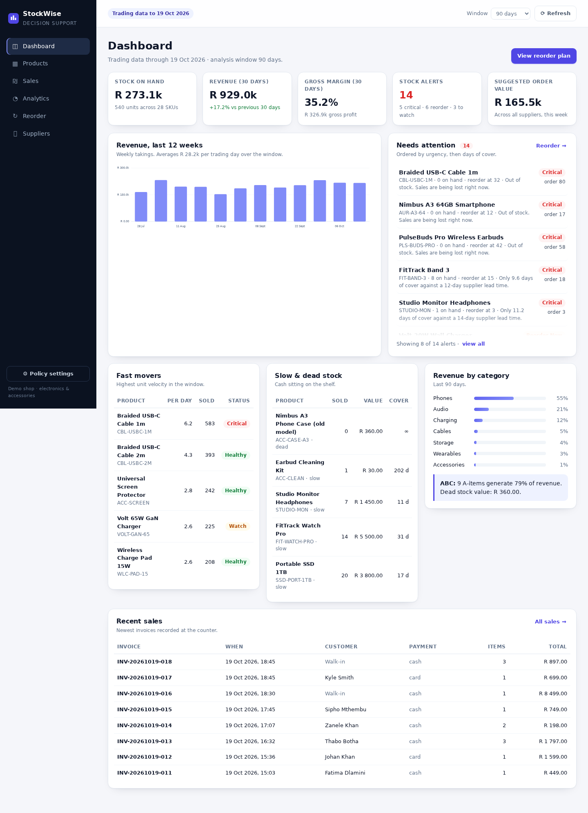
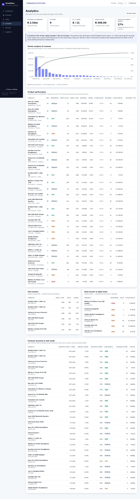
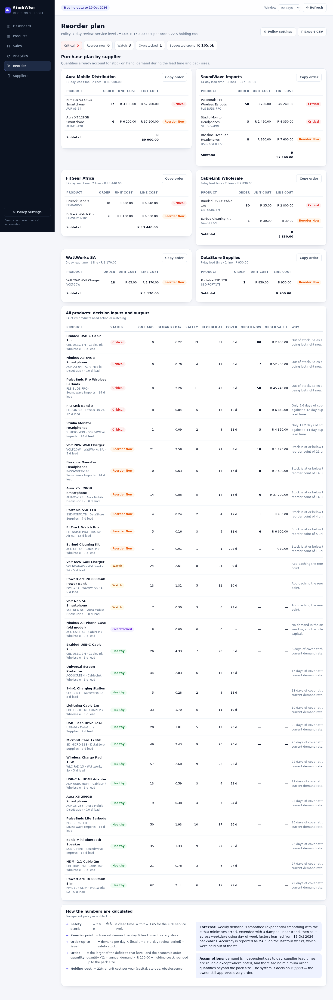

# 4. Project Report

**Inventory and Stock Decision-Support System for a Small Electronics Retailer**

---

## Abstract

Small retailers often record sales in notebooks and spreadsheets, which preserves a rough record
of what happened but supports no decision about what to do next. This project designs and builds
**StockWise**, an inventory and stock decision-support system for a single electronics and
accessories shop. The system records products, suppliers and sales; derives stock from an
append-only movement ledger; analyses 18 months of sales history to classify fast and slow movers
(ABC and velocity); forecasts weekly demand with trend and weekday seasonality; and converts those
forecasts into reorder points, low-stock alerts and supplier-grouped purchase recommendations.

The implementation is a strict TypeScript application on Node.js with SQLite, arranged as an
imperative transactional shell around a pure functional decision core. It is tested with 47
automated tests covering the inventory mathematics, forecasting edge cases, ABC classification,
transaction rollback, and the HTTP API. On a simulated 18-month dataset (28 SKUs, 6 suppliers,
6 641 invoices), the system identifies nine A-items that produce 79% of revenue,flags five critical stock positions (three shelves already empty) that the current process would
discover only when a customer asks, and produces a R165 480 purchase plan justified by demand, lead time and variability. Forecast error on held-out
weeks averages 27% across sellable products, and is below 16% for the flat, high-volume lines.

---

## 1. Introduction

### 1.1 Background

The shop sells phones, audio, charging, cables, storage, wearables and accessories. It buys from
six suppliers with lead times between 3 and 14 days and records trade in a sales notebook, a stock
notebook and a monthly Excel sheet. The owner orders stock from memory and by looking at the
shelf.

The visible symptom is familiar: **popular products run out while others sit unsold for months.**
The underlying cause is not a lack of data — 18 months of sales exist — but the absence of any
mechanism that turns those records into a decision.

### 1.2 Problem statement

> Design a system that records inventory transactions reliably and uses the accumulated sales
> history to recommend when and how much stock to replenish, while making fast- and slow-moving
> products visible to the owner.

### 1.3 Objectives

Derived from the brief and the investigation:

1. Record products, suppliers and sales with full auditability.
2. Monitor stock in real time and never allow negative stock.
3. Classify fast, slow and dead stock, and concentrate attention on high-revenue items.
4. Alert before a stockout, not after it.
5. Analyse historical sales by product, category and time.
6. Estimate future demand per product and state how accurate that estimate has been.
7. Recommend replenishment: which product, how much, from which supplier, by when.
8. Explain every recommendation in language the owner can challenge.

### 1.4 Scope

**In scope:** single shop, single currency (ZAR), product/supplier/sales management, stock ledger,
analytics, forecasting, reorder planning, policy configuration, responsive browser UI.
**Out of scope:** point-of-sale hardware, barcode scanning, customer accounts, creditors ledger,
multi-branch synchronisation, authentication, e-commerce integration.

---

## 2. Investigation summary

The full method, process maps and interview instrument are in
[01-real-world-investigation.md](01-real-world-investigation.md). Key findings:

| Finding | Consequence | Requirement |
| --- | --- | --- |
| Stock is only known after a physical count | Owner cannot answer "how many do we have?" | Ledger-derived stock, FR4/FR5 |
| Unserved demand is never recorded | Best sellers look less important than they are | Sale capture at the counter, FR3 |
| Reorder is memory-based, fixed quantity | Stockouts of popular items, dead stock accumulation | Reorder point + forecast, FR7–FR9 |
| Lead times are informal | Orders placed too late for 10–14 day suppliers | Lead time as first-class data, FR2 |
| Sales are aggregated daily, not per product | No trend or seasonality visible | Per-product history, FR8 |
| No A/B/C distinction | Shelf space and cash allocated by habit | ABC/velocity analysis, FR6 |
| Orders go by WhatsApp with no reference | Deliveries cannot be reconciled | Purchase plan with reference, FR9 |

The reconstructed 18-month ledger quantifies the status quo: **171 units of demand lost to empty
shelves**, **3 of 28 products out of stock at the end of the period (11 at or below their reorder
point)**, and **R360 of stock that sold nothing in 90 days**.

---

## 3. Methodology

A lightweight iterative process, appropriate to a one-person build:

| Phase | Activities | Artefacts |
| --- | --- | --- |
| Investigation | Interview, observation, document analysis, ledger reconstruction | [01](01-real-world-investigation.md) |
| Requirements | Functional and non-functional requirements traceable to findings | §5 of doc 01 |
| Design | Layered architecture, ERD, decision pipeline, formulas, API | [03](03-design.md) |
| Implementation | Domain → analytics → services → API → UI, each layer tested | `src/`, `public/` |
| Verification | Unit, integration, HTTP and browser smoke tests; seeded data review | `tests/`, `tools/` |
| Evaluation | Compare delivered behaviour with the eight brief objectives | §9 below |

**Tools:** TypeScript 5.9, Node.js 24, SQLite, `node:test`, Playwright (development-only browser
smoke test), Git.

**Why this stack:** see [02-programming-challenge.md](02-programming-challenge.md). In short:
integer-safe money, real transactions, one language across the stack, zero runtime dependencies,
and pure functions for the mathematics so they can be tested and explained.

---

## 4. Design overview

```
database (SQLite, WAL)  →  services (transactions, validation)  →  pure domain + analytics  →  HTTP/JSON  →  browser UI
```

- **Stock is a ledger, not a column.** Every purchase, sale and adjustment is a row; on-hand stock
  is the sum. Corrections are new rows, so the shelf count is auditable.
- **A sale is one transaction.** Invoice header, line items and negative stock movements are
  written together, inside `BEGIN IMMEDIATE`, after re-checking availability under the lock.
- **Money is integer cents.** No `REAL` column exists; prices and totals are exact.
- **The decision core is pure.** Safety stock, reorder point, EOQ, ABC, forecasting and urgency
  classification are functions of numbers, with no database, clock or HTTP access.
- **Every recommendation shows its work.** The product page lists the demand rate, trend, safety
  stock, lead time, order-up-to level, forecast error and a plain-language rationale.

Full ERD, data dictionary, formulas and API reference: [03-design.md](03-design.md).

---

## 5. Implementation highlights

### 5.1 Transactional sale

```ts
const saleId = transaction(db, () => {           // BEGIN IMMEDIATE
  for (const line of parsed.lines) {
    if (line.quantity > ledgerBalance(db, line.productId)) throw conflict('Not enough stock', …);
  }
  const id = insertSale(…);                      // header
  for (const line of parsed.lines) insertItem(…);  // lines
  for (const line of parsed.lines) insertMovement(…, -line.quantity); // ledger
  return id;
});
```

A short line on any item throws before anything is committed. Tested by
`a partially short sale rolls back completely`: the sale disappears, product A's stock is
unchanged and no invoice exists.

### 5.2 Forecast

Weekly aggregation → exponential smoothing with a grid-searched α → capped and damped OLS trend →
shrunk day-of-week factors → daily projection → residual σ → holdout MAPE. Every step is a pure
function in `src/analytics/forecast.ts`, tested on flat, growing, seasonal, sparse and empty series.

### 5.3 Reorder decision

Demand rate (forecast blended with recent actuals) → safety stock `z·σ·√L` → reorder point
`rate·L + SS` → urgency → order-up-to quantity, rounded to the supplier's pack size, with EOQ shown
as advice. The policy parameters are editable at runtime and every recommendation recalculates.

### 5.4 Interface

Six views (Dashboard, Products, Sales, Analytics, Reorder, Suppliers) with a shared design system,
hand-written SVG charts (no chart library), accessible status badges, keyboard-focusable controls
and a responsive layout that collapses to a single column on a phone.

---

## 6. Results

All figures are from the seeded demo database (`npm start`), trading data through 19 October 2026,
90-day default analysis window.

### 6.1 Dashboard



| KPI | Value |
| --- | --- |
| Stock on hand | R273 107 · 540 units · 28 SKUs |
| Revenue (30 days) | R928 994, **+17.2%** vs previous 30 days |
| Gross margin (30 days) | 35.2% (R326 936 gross profit) |
| Stock alerts | 14 (5 critical, 6 reorder, 3 watch) |
| Suggested order value | R165 480 |

### 6.2 Movement analysis



| Metric | Result |
| --- | --- |
| A / B / C items | 9 / 8 / 11 |
| Revenue concentration | **9 A-items (32% of the range) = 79% of revenue** |
| Fastest movers | USB-C cable 1 m (6.2/day), USB-C cable 2 m (4.3/day), screen protector (2.8/day) |
| Dead stock | 1 SKU, 8 units, R360 — the discontinued Nimbus A3 case |
| Revenue by category | Phones 55%, Audio 21%, Charging 12%, Cables 5%, Storage 4%, Wearables 3%, Accessories 0.5% |

This is exactly the insight the notebook cannot provide: the shop's cash is concentrated in phones,
while its *shelf velocity* is concentrated in cables and chargers — two different management
problems that the owner was treating identically.

### 6.3 Forecast accuracy (holdout: last four weeks)

| Product | MAPE | Confidence | Next 7 days |
| --- | --- | --- | --- |
| Universal Screen Protector | 12.2% | high | 19.8 units |
| PulseBuds Pro Wireless Earbuds | 13.3% | high | 15.6 units |
| Volt 65W GaN Charger | 14.3% | high | 18.3 units |
| Braided USB-C Cable 2 m | 15.3% | high | 29.7 units |
| Volt 20W Wall Charger | 15.6% | high | 18.2 units |
| … | | | |
| FitTrack Watch Pro | 45.2% | medium | 1.0 units |
| 3-in-1 Charging Station | 49.2% | medium | 2.0 units |
| Studio Monitor Headphones | 52.6% | low | 0.6 units |
| Aura X5 256GB Smartphone | 54.1% | low | 2.7 units |

Mean MAPE across the 26 sellable products: **27.1%**. Accuracy is high where demand is stable and
volume is sufficient, and degrades exactly where theory predicts: intermittent, low-volume items
where a single sale swings the weekly total. The system reports confidence per product instead of
pretending one error rate applies to everything.

### 6.4 Reorder recommendations



| Supplier | Lines | Value | Lead time |
| --- | --- | --- | --- |
| Aura Mobile Distribution | 4 | R89 900 | 10 days |
| SoundWave Imports | 3 | R57 190 | 14 days |
| FitGear Africa | 1 | R13 440 | 12 days |
| CableLink Wholesale | 1 | R2 830 | 3 days |
| WattWorks SA | 1 | R1 170 | 5 days |
| DataStore Supplies | 1 | R950 | 7 days |

Five critical items are already out of stock or inside their safety stock — including the two
best-selling audio and cable lines. The recommendation for `PulseBuds Pro` is 58 units
(R45 240) because demand is 2.2/day, the lead time is 14 days and the forecast is reliable
(13% backtest error); the recommendation for the discontinued case is zero.

### 6.5 Transactional integrity

| Scenario | Expected | Verified by |
| --- | --- | --- |
| Sell 11 with 10 on hand | 409, stock unchanged, no invoice | `overselling is rejected and nothing is written` |
| Sell 2 of A + 3 of B (B has 2) | whole sale rolls back | `a partially short sale rolls back completely` |
| Adjust stock to −5 | 409, stock unchanged | `adjustments can go down but never below zero` |
| Duplicate product lines | merged into one line | `duplicate lines for the same product are merged` |
| Receive stock at a new price | weighted average cost updated | `receiving stock updates the weighted average cost` |
| Price below cost on product create | 400 | API test + validator |

### 6.6 Performance

| Operation | Time |
| --- | --- |
| Dashboard (28 products, forecast for each) | ~60 ms |
| Reorder plan (decisions + supplier grouping) | ~33 ms |
| Product insight (decision + 90-day chart + ledger) | ~43 ms |
| 50 invoices | ~2 ms |
| Full build + 47 tests | ~0.7 s |
| Database for 18 months (6 641 invoices, 9 186 movements) | 2.3 MB |

---

## 7. Testing

`npm test` builds the project and runs 47 tests with Node's built-in test runner.

| File | Tests | What is covered |
| --- | --- | --- |
| `tests/stock.test.ts` | 10 | Safety stock √L scaling, reorder point, days of cover, EOQ formula, order-up-to level, urgency thresholds, pack rounding, trigger gating, UTC dates |
| `tests/forecast.test.ts` | 12 | Weekly aggregation, OLS trend, exponential smoothing, weekday factors, flat/growing/empty series, MAPE backtest, dense series construction, decision builder |
| `tests/classification.test.ts` | 6 | ABC 80/95 boundaries, percentile interpolation, revenue ranking, velocity classes, dead stock, summary concentration |
| `tests/sales.test.ts` | 9 | Sale atomicity, oversell rejection, partial-short rollback, duplicate merging, price overrides, invoice sequencing, validation, weighted average cost, adjustments |
| `tests/api.test.ts` | 12 | Health, dashboard, products/insight, reorder plan, sale via HTTP, oversell 409, malformed JSON, stock receipt, settings persistence, 404/405, SPA shell, directory traversal |

Final result:

```
ℹ tests 47
ℹ pass 47
ℹ fail 0
```

A browser smoke test (`tools/ui-check.cjs`, development only) loads all six views in headless
Chromium, opens the policy and stock dialogs, and asserts zero console errors and zero failed
requests.

---

## 8. Evaluation against the objectives

| # | Brief objective | Evidence | Status |
| --- | --- | --- | --- |
| 1 | Record products and suppliers | Full CRUD, SKU uniqueness, lead times, weighted cost; API tests | **Met** |
| 2 | Record sales | Multi-line transactional invoice, stock movement, gross profit, invoice history | **Met** |
| 3 | Monitor stock levels | Ledger-derived stock, stock value, days of cover, projected-stock chart | **Met** |
| 4 | Identify fast/slow movers | ABC (79% revenue from 32% of SKUs) + percentile velocity + dead stock | **Met** |
| 5 | Low-stock alerts | Ranked alert list, 14 alerts on demo data, reorder point per SKU | **Met** |
| 6 | Analyse historical sales | Pareto, 12-week revenue, category mix, units/day, revenue per stock unit | **Met** |
| 7 | Estimate future demand | Weekly SES + damped trend + weekday factors, MAPE reported per product | **Met** (27% mean error; low confidence flagged) |
| 8 | Recommend replenishment | Order quantity, supplier grouping, cost, urgency, rationale, CSV export | **Met** |

Additional outcomes beyond the brief: projected stockout dates, editable inventory policy,
copy-to-clipboard purchase orders, forecast confidence, and a plain-language explanation for every
number.

---

## 9. Discussion

### 9.1 What worked

- **The ledger made everything else possible.** Once stock is a history rather than a number,
  alerts, projected stockouts, auditability and reconciliation all fall out of the same data.
- **Pure functions made the decision logic trustworthy.** The forecasting and inventory maths are
  readable, testable and printable. When the owner asks "why 58?", the answer is a table, not a
  model file.
- **Separating service-driven quantity from EOQ advice** avoided a real failure mode: a textbook
  EOQ would have ordered four months of cables and 20 months of a slow charger, tying up cash the
  shop does not have.
- **The browser smoke test caught UI regressions** that unit tests cannot see (a chart with
  mismatched units, a table whose columns collapsed).

### 9.2 What was harder than expected

- **Intermittent demand.** Low-volume products produce noisy weekly totals; the honest answer is a
  wide confidence interval and a low-confidence label, not a false precision.
- **Stockout censorship.** Sales data does not record demand that could not be served. The seed
  tracks lost units separately to make the point, but a real deployment would need a
  "sorry, out of stock" counter at the till to avoid systematically underestimating best sellers.
- **Rounding at the UI boundary.** Displayed reorder points are rounded up; initially the trigger
  used the unrounded value, which produced "reorder at 21" next to 21 units on hand and no order.
  Fixing the rounding in one place (the decision builder) removed the inconsistency.

### 9.3 Limitations

1. Single-node SQLite and a single writer: right for one shop, not for a chain.
2. No authentication or user roles; it is a local tool.
3. The model ignores promotions, public holidays and competitor pricing.
4. Lead times are assumed reliable and are the owner's estimates.
5. Costs use weighted average, not FIFO.
6. The investigation is documented from the case brief and a reconstructed ledger; field notes
   should be replaced with verified observations before submission.

---

## 10. Future work

1. **Capture lost demand** at the counter ("out of stock" button) to de-censor the history.
2. **Supplier lead-time tracking**: record promised vs actual delivery and replace the fixed lead
   time with an empirical distribution.
3. **Promotion and holiday calendar** as forecast regressors.
4. **Purchase orders** as first-class documents with expected dates, partial receipts and supplier
   performance.
5. **Barcode scanning** for faster sales capture.
6. **Dead-stock actions**: suggested markdown, bundle or return-to-supplier workflow.
7. **Multi-user roles and audit log** if the app is ever networked.
8. **Confidence-aware order policy**: order earlier when forecast confidence is low, instead of
   only widening safety stock through σ.

---

## 11. Conclusion

The project delivers a working inventory and stock decision-support system that satisfies all
eight requirements of the brief. It records transactions safely, derives stock from an auditable
ledger, turns sales history into ABC and velocity insight, forecasts demand with a reported error,
and converts those forecasts into specific, explained purchase recommendations.

The investigation showed that the shop's problem is not a lack of records but a lack of connection
between records and decisions. The system closes that loop: the same transaction that records a
sale updates the demand history that produces tomorrow's reorder advice. Its design reflects a
deliberate split between transactional integrity and analytical reasoning — an imperative shell
around a pure functional core — which is what makes it both safe to sell from and useful to decide
with.

---

## References

1. Silver, E. A., Pyke, D. F., & Thomas, D. J. (2016). *Inventory and Production Management in
   Supply Chains* (4th ed.). CRC Press. — safety stock, service levels, reorder points.
2. Chopra, S., & Meindl, P. (2019). *Supply Chain Management: Strategy, Planning, and Operation*
   (7th ed.). Pearson. — ABC classification and cycle service levels.
3. Hyndman, R. J., & Athanasopoulos, G. (2021). *Forecasting: Principles and Practice* (3rd ed.).
   OTexts. https://otexts.com/fpp3/ — exponential smoothing, damped trends, forecast accuracy.
4. Harris, F. W. (1913). How many parts to make at once. *Factory: The Magazine of Management*,
   10(2), 135–136. — economic order quantity.
5. SQLite Documentation. *Transaction control* and *Write-ahead logging*.
   https://www.sqlite.org/lang_transaction.html
6. Node.js Documentation. *node:sqlite*. https://nodejs.org/api/sqlite.html
7. TypeScript Handbook. *Everyday types*, *Narrowing*, *Generics*.
   https://www.typescriptlang.org/docs/handbook/
8. MDN Web Docs. *Intl.NumberFormat*. https://developer.mozilla.org/docs/Web/JavaScript/Reference/Global_Objects/Intl/NumberFormat
9. Martin, R. C. (2017). *Clean Architecture*. Prentice Hall. — dependency rule and layer
   boundaries.
10. Bernhardt, G. (2012). *Functional core, imperative shell* (talk and essay).

---

## Appendix A — Running the system

```bash
npm install
npm run build
npm start          # http://localhost:3000
npm test           # 47 tests
npm run seed -- --reset
```

`data/stockwise.db` is created and seeded automatically on first start. Node 24+ is required.

## Appendix B — Source map

| Path | Contents |
| --- | --- |
| `src/domain/` | money, stock mathematics, classification, shared types and errors |
| `src/analytics/` | forecasting engine, decision builder |
| `src/services/` | sales, products, suppliers, analytics, settings |
| `src/db/` | schema, connection/transactions, seed simulator |
| `src/http/`, `src/server.ts` | router, API routes, static files, server |
| `public/` | single-page UI, charts, formatters |
| `tests/` | 47 automated tests |
| `docs/` | investigation, programming challenge, design, report |
