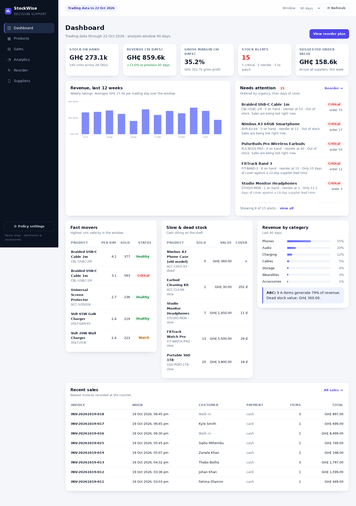
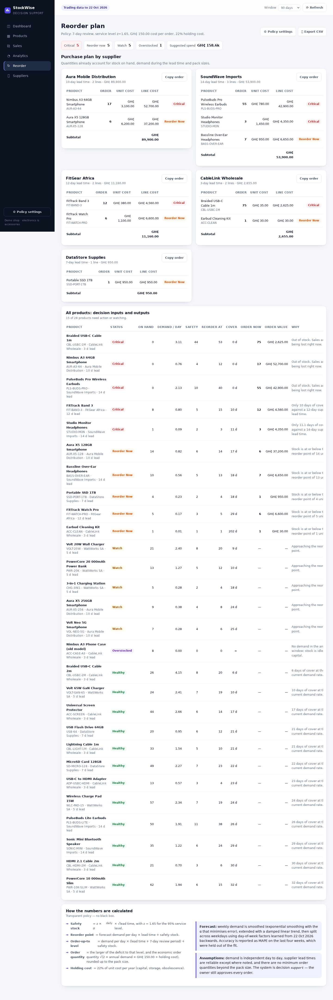
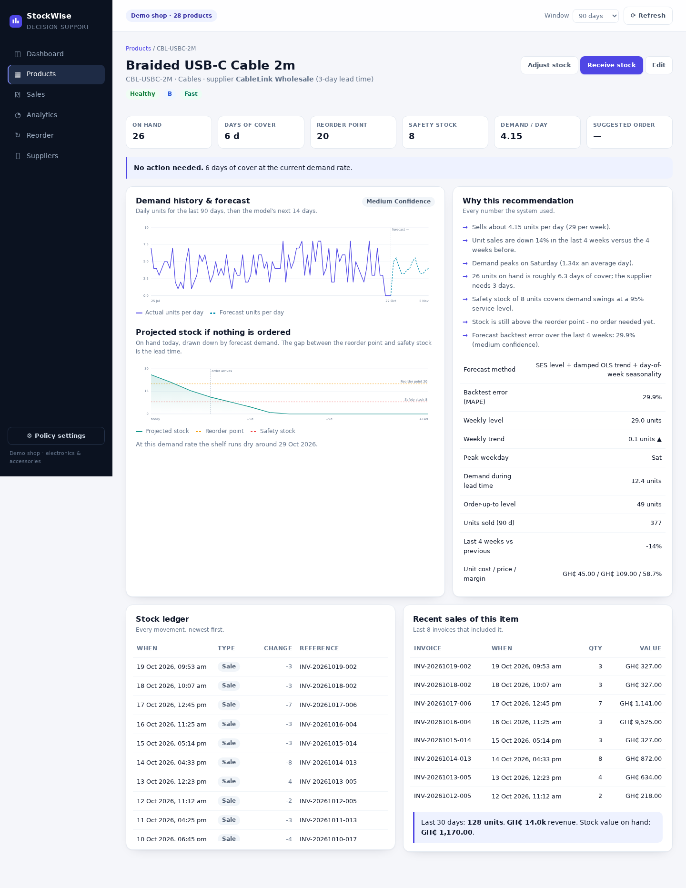
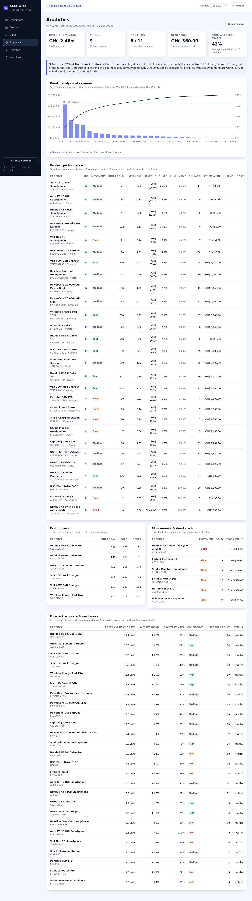
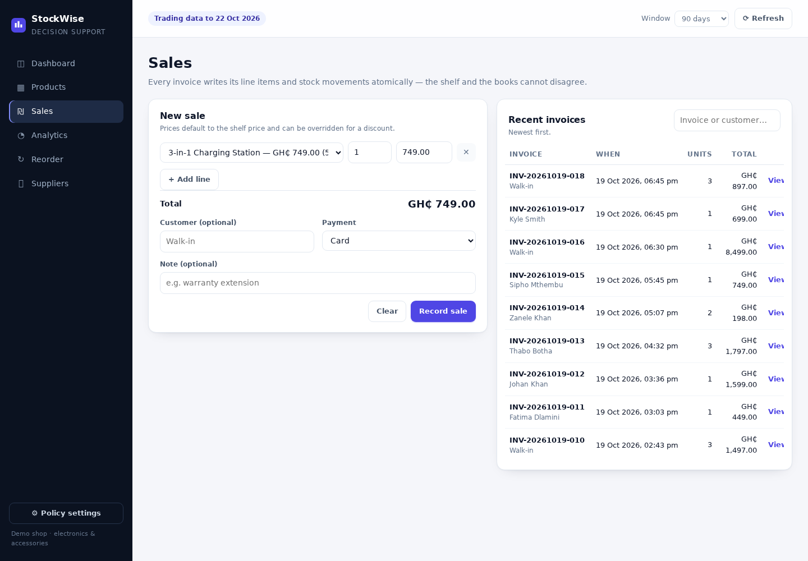

# StockWise — Inventory & Stock Decision Support

An inventory system for a small electronics retailer that does more than record products: it
uses 18 months of sales history to forecast demand, classify fast and slow movers, warn about
low stock, and recommend what to order, how much, and when.

Built for the assignment *"Inventory and Stock Management for a Small Business"* — including the
Real-World Investigation and the Programming Challenge write-up.

The project is split in two independent folders:

- **`backend/`** — the JSON API, the SQLite database, the forecasting and stock mathematics.
- **`frontend/`** — the browser UI (static ES modules) plus a small server that serves it and
  proxies `/api/*` to the backend.



---

## Quick start

Requirements: **Node.js 24 or newer** for the backend (it uses the built-in `node:sqlite` module —
no native builds, no runtime dependencies). The frontend only needs Node 20+.

Run the two halves in two terminals:

```bash
# terminal 1 — API on http://localhost:3001
cd stockwise/backend
npm install          # TypeScript tooling only
npm run build
npm start

# terminal 2 — UI on http://localhost:3000
cd stockwise/frontend
npm start
```

Open **http://localhost:3000**. The frontend server proxies `/api/*` to `http://127.0.0.1:3001`,
so the browser talks to a single origin.

On first start the backend creates `backend/data/stockwise.db` and seeds it with 18 months of
simulated trading history (28 products, 6 suppliers, ~6 600 invoices).

Other commands:

```bash
cd stockwise/backend
npm test                        # build + 47 automated tests
npm run seed -- --reset         # wipe and regenerate the demo data
npm run dev                     # build and run in one step
PORT=8080 npm start             # different API port
DB_PATH=./data/other.db npm start
CORS_ORIGIN=http://localhost:3000 npm start   # restrict cross-origin access
```

```bash
cd stockwise/frontend
npm test                        # static serving + API proxy tests
PORT=4000 API_TARGET=http://localhost:8080 npm start   # point at another API
```

---

## Deploying to Render

The repo ships a **`render.yaml`** Blueprint with one service per folder, so no manual dashboard
configuration is needed:

1. Push the repository to GitHub.
2. In Render: **New → Blueprint →** select the repo. Render reads `render.yaml` and creates both
   services with the build commands, start commands, health checks and environment below.
3. The first API deploy seeds the database automatically (~200 ms); the UI is served by
   `stockwise-ui` and proxies `/api/*` to `stockwise-api`.

| Service | Folder | Build | Start | Health check |
| --- | --- | --- | --- | --- |
| `stockwise-api` | `stockwise/backend` | `npm ci --include=dev && npm run build` | `npm start` | `/api/health` |
| `stockwise-ui` | `stockwise/frontend` | none (no dependencies) | `node server.js` | `/` |

Notes:

- `npm ci` installs strictly from `package-lock.json`; `--include=dev` keeps TypeScript available
  for the build (`NODE_ENV=production` would otherwise strip devDependencies).
- The API runs `node dist/src/main.js` and binds `0.0.0.0` on Render's `PORT`; Node stays on
  `24.x` because of the bounded `engines.node: ">=24 <25"` — the upper bound stops Render
  silently moving to a future major that `node:sqlite` may not match.
- The UI gets `API_TARGET` from the API service hostname (`fromService`), so the two services are
  wired together without hard-coding a URL. `API_TARGET` accepts a bare host or a full URL.
- Because the frontend server proxies the API, the browser never makes a cross-origin request in
  this setup. The API still sends CORS headers (`CORS_ORIGIN` defaults to `*`) so the UI can also
  be hosted elsewhere.

**Data on the free plan:** the filesystem is ephemeral — the SQLite file is lost on every
redeploy, restart or 15-minute spin-down. This is not an error: the app re-seeds the full demo
database on next boot (~200 ms). To keep data permanently, upgrade the API instance to a paid
plan, attach a Disk (e.g. mounted at `/var/data`), and set `DB_PATH=/var/data/stockwise.db` in its
environment variables (the commented-out entry in `render.yaml` shows where).

---

## What it does

| Brief requirement | Where it lives in the app |
| --- | --- |
| Record products and suppliers | **Products** and **Suppliers** pages (full CRUD) |
| Record sales | **Sales** page: multi-line invoice, price overrides, payment method |
| Monitor stock levels | **Dashboard** KPIs, per-product stock ledger, projected stock chart |
| Identify fast/slow movers | **Analytics**: ABC analysis, velocity percentiles, revenue per stock unit |
| Generate low-stock alerts | **Dashboard** "Needs attention", **Reorder** alert chips and table |
| Analyse historical sales | **Analytics**: Pareto chart, category mix, 12-week revenue trend |
| Estimate future demand | Per-product forecast (trend + weekday seasonality) with a MAPE backtest |
| Recommend replenishment | **Reorder**: supplier-grouped purchase plan, quantities, cost, reasoning |

Decision-support outputs are always explained in plain language next to the number, and the
inventory policy (service level, review period, ordering cost, holding rate) is editable in
**Policy settings** — every recommendation recalculates immediately.

---

## Screens

| Reorder plan | Product insight |
| --- | --- |
|  |  |

| Analytics | Sales |
| --- | --- |
|  |  |

---

## Tech stack

- **TypeScript** (strict, `noUncheckedIndexedAccess`) — one typed language for the domain, the
  API and the browser code.
- **Node.js 24** with the built-in HTTP server and `node:sqlite`. No Express, no ORM, no runtime
  dependency at all, so the marker can run it with `npm install && npm start`.
- **SQLite** in WAL mode: real transactions, foreign keys, check constraints.
- **Vanilla ES modules + hand-written SVG charts** in the browser.
- **`node:test`** for unit, integration and HTTP tests, on both sides of the split.

The reasoning behind those choices is written up in
[docs/02-programming-challenge.md](docs/02-programming-challenge.md).

---

## Architecture at a glance

```
frontend/  browser UI (js/**)
        │  same-origin fetch → /api/*
        ▼
frontend/server.js   static files + reverse proxy to the API
        │  JSON over HTTP
        ▼
backend/   HTTP layer   src/server.ts · src/http/{router,api}.ts
        ▼
services   sales · products · suppliers · analytics · settings
        ▼                │
domain + analytics       pure functions: stock maths, ABC/velocity, forecasting
        ▼
SQLite     WAL, integer cents, append-only stock ledger
```

The only coupling between the two folders is the JSON API: the backend never serves HTML or
static files, and the frontend never touches the database.

- Money is stored as **integer cents**, never floating point.
- Stock is **not a column**: it is the sum of an append-only movement ledger.
- A sale writes its header, line items and stock movements in **one transaction**; a short line
  rolls the whole sale back.
- All forecasting and reorder mathematics are **pure functions** with no I/O, unit tested in
  isolation.

Full design, ERD and formulas: [docs/03-design.md](docs/03-design.md).

---

## Project structure

```
stockwise/
  backend/
    src/
      domain/      money.ts, stock.ts (safety stock, ROP, EOQ), classification.ts, types.ts
      analytics/   forecast.ts (SES + trend + seasonality + MAPE), decision.ts
      services/    sales.ts, products.ts, suppliers.ts, analytics.ts, settings.ts
      http/        router.ts (regex routes, JSON, errors), api.ts
      db/          schema.ts, connection.ts, seed.ts, seed-cli.ts
      server.ts    HTTP server (API only, CORS)
      main.ts      entry point
    tests/         47 tests: stock maths, forecasting, classification, sales, HTTP API
    package.json, tsconfig.json, data/ (created at runtime)
  frontend/
    index.html, styles.css
    js/            app.js, api.js, format.js, ui.js, charts.js, views/*
    server.js      static file server + /api proxy (zero dependencies)
    tests/         4 tests: app shell, assets, API proxying, traversal protection
    tools/         ui-check.cjs (headless browser smoke test, dev only)
  docs/            investigation, programming challenge, design, report
  artifacts/       screenshots used by the docs
render.yaml        Blueprint: stockwise-api + stockwise-ui
```

---

## API

| Method | Path | Purpose |
| --- | --- | --- |
| GET | `/api/health` | Liveness and product count |
| GET | `/api/dashboard?window=90` | KPIs, alerts, movers, trend, categories |
| GET | `/api/products` | Catalogue with live stock (`search`, `category`, `includeInactive`) |
| POST/PUT | `/api/products[/:id]` | Create / update a product |
| GET | `/api/products/:id/insight?window=90` | Decision, forecast, chart series, ledger, sales |
| POST | `/api/products/:id/stock` | Receive purchase / return / adjustment |
| GET | `/api/suppliers` | Suppliers with product count and stock value |
| POST/PUT/DELETE | `/api/suppliers[/:id]` | Maintain suppliers |
| GET/POST | `/api/sales` | Sales history / record a sale |
| GET | `/api/sales/:id` | Invoice with line items |
| GET | `/api/reorder?window=90` | Full decision set + supplier purchase plan |
| GET | `/api/alerts` | Low-stock alerts only |
| GET | `/api/analytics/movement?window=90` | ABC + velocity analysis |
| GET/PUT | `/api/settings` | Inventory policy parameters |

Errors are JSON: `{ "error": { "code", "message", "details" } }` with 400/404/409/405 statuses.
Every other path on the API returns a JSON 404 — HTML lives in `frontend/`.

---

## Demo data

The seed is a deterministic discrete-event simulation, not random rows:

- 540 days of trading (2025-04-28 → 2026-10-19), 28 SKUs, 7 categories, 6 suppliers.
- Each SKU has its own demand level, weekly trend (growing / declining / steady) and month
  seasonality (December and Black Friday peaks, quiet January).
- The simulated owner reorders at a reorder point and waits for the lead time, so the history
  contains real stockouts: **171 units of demand were lost**, three products are out of stock at
  the end of the history and eleven sit at or below their reorder point.
- One supplier misses its last delivery, one product was discontinued 15 months ago (dead stock),
  and the `FitTrack Band 3` is trending — exactly the patterns the analytics are meant to find.

Regenerate any time with `npm run seed -- --reset` from `backend/`. The PRNG is fixed, so the same
day's seed produces the same dataset.

---

## Tests

```
cd stockwise/backend && npm test
ℹ tests 47
ℹ pass 47
ℹ fail 0

cd stockwise/frontend && npm test
ℹ tests 4
ℹ pass 4
ℹ fail 0
```

Backend coverage includes safety stock / reorder point / EOQ edge cases, ABC and velocity
classification, forecast behaviour on flat, growing, empty and seasonal series, MAPE backtesting,
the decision builder, weighted-average costing, oversell rejection and full transaction rollback,
invoice numbering, policy settings validation, and the HTTP API end to end (including CORS and
the JSON-only 404 for non-API paths).

Frontend coverage includes serving the app shell and ES modules with correct content types,
proxying `/api/*` to the backend, and blocking directory traversal out of the frontend folder.

`frontend/tools/ui-check.cjs` is an optional headless-browser smoke test used during development;
it needs Playwright installed and is not part of `npm test`. Point it at the UI with
`BASE_URL=http://127.0.0.1:3000`.

---

## Documentation

1. [Real-world investigation](docs/01-real-world-investigation.md) — how the shop manages stock
   today, findings, requirements, interview guide.
2. [Programming challenge](docs/02-programming-challenge.md) — why TypeScript, Node and SQLite,
   and why the architecture mixes a transactional core with functional analytics.
3. [System design](docs/03-design.md) — ERD, data dictionary, formulas, API, assumptions.
4. [Project report](docs/04-report.md) — submission-ready write-up with results and evaluation.

---

## Known limitations

- Single-node SQLite: perfect for one shop and one process, not for multi-branch sync.
- The forecast is deliberately simple (weekly SES + damped trend + weekday factors). It is
  explainable and accurate enough for a small range, but it does not model promotions, holidays
  or competitor effects.
- Supplier lead times are treated as reliable and demand as independent day to day.
- No authentication: the app is a local decision-support tool, not a multi-user cloud service.
  The API has no credentials, so it relies on the proxy (or the CORS allowlist) rather than auth.
- The investigation in `docs/01` is a structured template based on the case brief; replace its
  observation notes with your own verified interview data before submitting.
